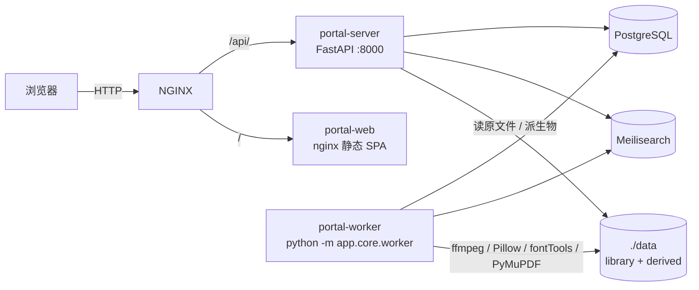

# 个人资源门户 · 技术指南

> 版本：按 2026-10-20 代码现状整理（HEAD `a1470d6`）  
> 配套：早期方案见 [总体规划](./personal-asset-portal-plan.md)、[详细设计](./personal-asset-portal-detail-design.md)（均为 2026-10-05，部分字段和端点已过时）；上线步骤见 [飞牛 NAS 部署指南](./deploy-fnos-nas.md)；M6 之后加了什么见 [近期功能变更](./changelog.md)。

本文写 **现在实际跑着的系统**：进程怎么分、表里有什么、文件怎么进来、五类资源各自怎么预览。读的时候可以先看 §1–§4 建立全局图，再按要改的模块跳到对应章节。

---

## 1. 这是什么

个人门户网站，把硬盘上已经有的 **字体、音乐、视频、书籍、图片** 做成可检索、可预览、可下载的资料库。

几条从立项就没改过的边界：

- **不搬文件、不改名。** 你的目录结构是事实标准。系统只登记索引，预览用的缩略图 / 样张 / 转码缓存在旁边的派生物目录。
- **不做下载器、不做社区、不做 HLS 多码率。** 视频能 Direct Play 就在线播，否则请下载。
- **多用户共用一个库。** 没有租户隔离。收藏是按人记的；上传、扫描、删文件、改元数据只有管理员能做。
- **单机。** 一套 Docker Compose（server + worker + 静态前端），接到机器上已有的 PostgreSQL、Meilisearch、NGINX。

生产地址：`http://192.168.31.31:8080`（飞牛 NAS，局域网 HTTP）。

---

## 2. 运行架构



三个容器同一镜像组、同一 Docker 网络（与 NGINX / PG / Meili 的既有网络 `external` 对接），**不往宿主机发端口**，公网只进 NGINX。

| 进程 | 做什么 | 不做什么 |
|---|---|---|
| `portal-server` | HTTP API、登录会话、Range 流、SSE 订阅 | **不消化任务**。只起 uvicorn 的话，扫描/解析/缩略图会一直停在队列里 |
| `portal-worker` | 轮询 `jobs` 表，跑扫描、指纹、解析、派生、建索引、打包 | 不对外服务 |
| `portal-web` | 托管 `web/dist`，SPA 回退到 `index.html` | 构建时 `VITE_API_BASE` 必须留空，请求走同源 `/api` |

server 启动时（`app/main.py` 的 lifespan）：

1. `alembic upgrade head`（独立连接，不堵事件循环）
2. `users` 表为空则创建引导管理员（`BOOTSTRAP_ADMIN_USERNAME` / `PASSWORD`）
3. 给 Meilisearch 建五个索引；Meili 挂了只打日志，API 照常起

worker 启动时靠 import 把各领域的 `@register("parse:…")` / `@register("derive:…")` 挂进全局 `HANDLERS`，然后按 `WORKER_CONCURRENCY`（默认 2）开协程领取任务。

本地开发等价物：

```bash
# 基础设施：本机已有 postgres-dev（5432）和 meilisearch-dev（7700）
cd server && .venv/bin/uvicorn app.main:app --reload --port 8000
cd server && .venv/bin/python -m app.core.worker   # 必须另开终端
cd web && npm run dev                              # :5173，代理到 :8000
```

改了后端解析/任务代码后 **worker 不会热加载**，要手动重启。验证前先看 8000 端口和 worker 进程是不是旧的还占着（旧进程会用旧代码抢任务）。

---

## 3. 技术栈

| 层 | 实际采用 |
|---|---|
| 后端 | Python 3.12、FastAPI、SQLAlchemy 2（async）+ asyncpg |
| 数据库 | PostgreSQL 16（生产 NAS 上是既有 PG 容器，版本 ≥13 即可，因为要用内置 `gen_random_uuid()`） |
| 搜索 | Meilisearch，五个索引（fonts / music / videos / books / images） |
| 任务 | `jobs` 表 + `FOR UPDATE SKIP LOCKED`，没有 Redis / Celery |
| 前端 | React 18、TypeScript、Vite 5、Tailwind、TanStack Query、zustand。没有组件库，没有 Axios |
| 媒体 | ffmpeg / ffprobe、Pillow、fontTools、mutagen、PyMuPDF、rawpy、pillow-heif |
| 鉴权 | argon2id 密码 + 服务端 `sessions` 表 + HttpOnly Cookie `portal_session` |
| 部署 | Docker Compose 三服务 + 外层 NGINX |

前端播放器全部是浏览器原生：`<video>` / `<audio>`；PDF 是服务端栅格化后的 ``；书籍 HTML 是自建分页/滚动，不用 epub.js。

---

## 4. 权限

库里的角色只有两种：`admin`、`member`。**游客不是一张用户表记录**，只是没有 Cookie。

Cookie 名 `portal_session`，滑动过期（默认 30 天，距过期不足 7 天续期）。用户被停用后，其全部会话立即失效。

| 能力 | 游客 | 注册用户 | 管理员 |
|---|---|---|---|
| 仪表盘统计、最近入库、五类浏览列表、分类树、标签列表、缩略图 / 封面 / 字体样张 | 可以 | 可以 | 可以 |
| 列表带关键词 `?q=`、全局搜索、详情、在线播/读、原文件下载、收藏、给自己打分 | 401 / 前端拦截 | 可以 | 可以 |
| 工具箱里的打包、智能集合 | — | 可以 | 可以 |
| 改标题 / 备注 / 标签 / 分类、删除资源、上传、扫描、任务中心、用户管理、设置、生成分享链接 | — | 403 或按钮隐藏 | 可以 |
| 注册 | 设置里「允许注册」打开时可以 | — | 可在设置里关掉注册 |

补充口径（和列表页能看到缩略图有关）：

- 缩略图、封面、字体样张视为「浏览的一部分」，**公开**，所以 `` 不用带 Cookie。
- 详情、原图、音视频流、PDF 页、下载必须登录。
- `PATCH /api/assets/{id}`：注册用户只能改 `rating` 和 `is_favorite`；改标题等字段要管理员。
- 标签管理页路由对登录用户开放，侧栏入口和写操作只给管理员。
- 仪表盘上的「任务摘要」登录就能看见，但 `/jobs` 是管理员路由，普通用户点进去会被送回首页。

---

## 5. 数据模型

命名：表名复数小写下划线；主键 UUID；时间 `TIMESTAMPTZ`。软删只用 `assets.deleted_at`。

Alembic 链（启动自动升到 head）：

```
e256f2a718d5 基线（M0–M6 共 21 张表）
  → b3f9a1c27d44 jobs.started_at
  → c4a8d1e29f33 assets.category / suggested_category
  → b8e4f6a2c1d7 users.email / phone
  → d7e2b9f4a1c3 user_favorites，并删除 assets.is_favorite
  → c5d8e2a71f46 video_details.chapter
```

### 5.1 用户与会话

`users`：`username` 唯一，`password_hash`（argon2id），`role`（admin / member），`email` / `phone` 选填且不唯一，`is_active`，`last_login_at`。

`sessions`：主键是 `secrets.token_urlsafe(32)`，用户删除时 CASCADE。

### 5.2 资产内核

`assets` 是五类共用的一张表：

| 列 | 含义 |
|---|---|
| `asset_type` | `font` / `music` / `video` / `book` / `image` |
| `status` | `pending` → 解析后 `ready` 或 `failed` |
| `storage_key` | 唯一。普通文件 `{扫描根别名}:{相对路径}`，例如 `fonts:serif/Noto.ttf`。CUE 分轨是虚拟键 `cue:{cue资产id}/track_NN.mp3` |
| `fingerprint` | ≤512MB 全文件 sha256；更大则首尾各 1MB + 大小 + mtime |
| `meta` | JSONB，领域私有字段（CUE 标记、解析警告、歌词、可变轴等） |
| `category` | 用户分类，自由文本，`/` 分层 |
| `suggested_category` | 解析器推荐，不覆盖已有 `category` |
| `rating` / `note` | 0–5 分、备注 |
| `deleted_at` | 非空 = 回收站 |

**没有独立的分类表。** 分类就是资产上的两个文本字段。前端用 `/` 拆成树。

**没有 `assets.is_favorite`。** 接口里的 `is_favorite` 是「当前登录用户是否收藏了这条」。游客恒为 `false`。

### 5.3 收藏、标签、设置、任务

- `user_favorites`：复合主键 `(user_id, asset_id)`，双向 CASCADE。
- `tags` + `asset_tags`：标签可挂父标签（换父时防环）。
- `settings`：KV。实际用到的 key：
  - `scan_roots`：`[{alias, path, types}]`，`types` 是该目录允许入库的资产类型白名单
  - `registration_open`：是否开放注册
  - `max_upload_gb`：单文件上传上限，1–128
  - `font_preview_text`：字体样张文案（派生任务读取；**管理设置接口不暴露这项**，前端设置页的预览文案存在浏览器 `localStorage`）
- `jobs`：`kind`、`payload`、`status`（queued / running / done / failed）、`priority`（数字越小越先跑）、`attempts`、`run_at`、`started_at`、`last_error`。失败按 30 秒 / 5 分钟 / 30 分钟退避，第四次仍失败则停。

### 5.4 领域扩展表

| 表 | 要点 |
|---|---|
| `font_details` | 字族、字重、是否可变、语言覆盖、字形数 |
| `music_artists` / `music_albums` / `music_tracks` | 艺术家 → 专辑 → 曲目。专辑封面按专辑存放 |
| `video_series` / `video_details` | `kind` = `clip` 或 `tutorial`；`episode` 集号；`chapter` 章号（可空）；`streamable` 能否 Direct Play |
| `book_details` | 作者数组、ISBN、格式（epub / pdf / mobi / azw3 / txt） |
| `image_details` | EXIF：机身、镜头、ISO、GPS、拍摄时间、宽高 |
| `image_albums` / `image_album_items` | 解析时按父目录自动聚相册。**目前没有列出相册的 HTTP 接口** |
| `user_progress` | 主键 `(user_id, asset_id)`。书：`{chapter, pct}`；视频：`{seconds}`；PDF 用 `chapter` 存页码 |
| `download_packs` / `share_links` / `saved_collections` | 打包、公开分享、智能集合 |

---

## 6. 入库管道

两条入口汇进同一条流水线：

```
扫描目录 / 网页上传
        ↓
   fingerprint（算指纹）
        ↓
   parse:{font|music|video|book|image}（读元数据、写扩展表、给推荐分类）
        ↓
   derive:*（缩略图 / 样张 / 封面 / 转码 / CUE 切片） + index_meili
```

上传走 `uploads:staging/{年-月}/{uuid}{ext}`，登记完立刻入队指纹（优先级比扫描更高）。`uploads` 默认扫描根允许全部五类。

### 6.1 扫描根与类型白名单

设置页为每个根配置：别名、磁盘路径、允许的类型。默认：

| 别名 | 默认路径 | 默认类型 |
|---|---|---|
| fonts / music / videos / books / images | `{DATA_ROOT}/library/<同名>/` | 仅对应一类 |
| uploads | `{DATA_ROOT}/library/uploads/` | 全部 |

扫描时扩展名对不上、或不在该根白名单里的文件 **直接跳过**（所以音乐文件夹里的 `cover.jpg` 不会进图片库）。库里已有、这次扫描又看不到的记录（文件被删、被移走、或后来被白名单排除）会 **软删**，并清掉 `derived/<分类>/<asset_id>/`，再更新搜索索引。

### 6.2 对账安全阀

「盘上没有就软删」在 NAS 上很危险：网盘没挂上时，目录会变成「不存在」或「空的」，误判会把整库送进回收站。

现行规则：

1. 先对根路径 `os.listdir`。这一步必须在创建存储对象之前——存储层会对缺失目录 `mkdir`，会把「没挂上」伪装成「空文件夹」。
2. 目录缺失或不可读 → **跳过对账**，打警告，库内记录不动。
3. 目录还在，哪怕里面 0 个文件 → 照常对账，盘上没有的记录软删（可恢复）。

CUE 分轨的 `storage_key` 以 `cue:` 开头，不属于任何扫描根，对账扫不到它们。母带 / CUE 表软删后，会按 `meta.cue_asset_id` 把孤儿分轨一并软删。

分类初始值：`category_from_key` 取相对路径去掉文件名后的全部父目录（`music:华语/周杰伦/七里香.flac` → `华语/周杰伦`）。根目录散文件和 `cue:` 键没有分类。

### 6.3 任务种类

| kind | 做什么 |
|---|---|
| `scan_root` | 扫一个别名对应的目录 |
| `fingerprint` | 算指纹，再入队 `parse:{类型}` |
| `parse:font` / `parse:music` / `parse:video` / `parse:book` / `parse:image` | 领域解析 |
| `index_meili` | 写入或删除 Meili 文档（软删时删文档） |
| `derive:font_specimen` / `derive:font_charset` | 样张 PNG、字符集覆盖率 JSON |
| `derive:thumb_image` | 256 / 1024 / 2560 WebP |
| `derive:book_cover` / `derive:music_cover` | 封面 WebP |
| `derive:music_stream` | 非原生格式 / 多声道 → `stream.mp3` |
| `derive:cue_slices` | 预切 CUE 全部分轨 |
| `pack_zip` | 批量打包下载 |

任务中心前端对多数 kind 有中文名。`derive:music_stream`、`derive:cue_slices` 目前没有单独文案，会显示原始代码。

入队函数 `enqueue()` **自己 commit**。历史上只 flush、等请求结束再提交，结果外层回滚把索引任务吃掉了。改任务相关代码时不要改回「只 flush」。

状态变更走 `pg_notify('portal_jobs')`。任务中心用 `GET /api/admin/jobs/stream` 收 SSE（快照 + 15 秒心跳）。事件只当信号，完整行还是查表。删除任务只删 `jobs` 行，不动资产；运行中的任务拒绝删除。

---

## 7. 分类、收藏、搜索

### 7.1 分类三层

1. **目录继承**（扫描写入 `category`）
2. **手动**（详情编辑、批量 `POST /api/assets/batch-category`，管理员）
3. **推荐**（解析器写 `suggested_category`，用户点「采纳」才拷到 `category`）

列表 `?category=` 按精确路径或前缀 `路径/%` 过滤；`__uncategorized__` 表示 `category IS NULL`。聚合接口 `GET /api/{fonts|music|videos|books|images}/categories` 给侧栏树用。

各类型推荐规则（关键词启发式，不是机器学习）：

| 类型 | 例子 |
|---|---|
| 字体 | 等宽/代码、无衬线/黑体、衬线/宋体、手写/书法、创意/像素、西文字体、通用字体 |
| 音乐 | 影视原声、古典、动漫游戏、爵士蓝调、摇滚金属、民谣吉他、轻音乐/纯音、流行；否则短 genre 原样 |
| 视频 | 编程技术教程、影视设计教程、教程系列、剪辑素材、影视片段、素材片段 |
| 书籍 | 计算机与技术、文学艺术、经济管理、人文社科、科学科普、生活休闲 |
| 图片 | 有相机信息 → 摄影相片；大横图 → 电脑壁纸；大竖图 → 手机壁纸；小图 → 图标表情；svg/ai/psd/ico → 设计矢量；其余插画图形 |

### 7.2 收藏

`PATCH /api/assets/{id}` 带 `is_favorite`：对当前用户 `INSERT … ON CONFLICT DO NOTHING` 或 `DELETE`。列表 `?favorite=true` 只返回此人的收藏；游客请求该过滤会得到空列表。

「我的收藏」页（`/favorites`）是前端对五类各打一次 `favorite=true` 的聚合，后端没有单独的 `/api/favorites`。

### 7.3 搜索

Meili 文档字段：`id, type, title, file_name, note, tags[], category, rating, created_at, size_bytes`。可过滤 `type / tags / rating / category`，可搜标题、文件名、备注。

`GET /api/search` 需登录：按五个索引 multi-search，可 `types`、`tag`、每索引 `limit`（默认 8，上限 50）。**搜索接口目前没有 category 查询参数**（虽然索引里有该字段）。

浏览列表上的 `?q=` 是 PostgreSQL `ILIKE`，不走 Meili；游客带 `q` 会 401。

⌘K 命令面板和 `/search` 页走同一搜索 API。

---

## 8. 五类资源

扩展名权威表在 `server/app/core/registry.py` 的 `EXT_TO_TYPE`。对不上的文件扫描时忽略。

### 8.1 字体

**格式：** `.ttf .otf .woff .woff2`

fontTools 读 name 表 / OS/2 / 可变轴 `fvar` / cmap 语言。坏文件仍入库，`meta.parse_warning` 记原因。

派生物：`derived/fonts/{id}/specimen.png`（约 1024×360）、`charset.json`（基本拉丁 / CJK / 假名 / 谚文覆盖率）。

前端按 `family` 聚成字族卡，用 `FontFace` 加载 `/api/fonts/{id}/file` 真渲染；失败回落样张图。详情可切字重、拖可变轴、看覆盖率、下一份字族 ZIP（`GET /api/fonts/{id}/family-pack`）。

### 8.2 音乐

**入库格式：** mp3 / flac / m4a / ogg / wav / dts / dtshd / ape / dsf / dff / aiff / aif / opus / wma / alac / **cue**

浏览器不能直接播的（DTS、APE、DSD、AIFF、WMA、ALAC）以及多声道，在线播放走 `derived/music/{id}/stream.mp3`（320 kbps 立体声）。下载始终是母带。

标签：mutagen easy tags，缺标签则用路径兜底（第一段当艺术家、倒数第二段当专辑）。封面顺序：内嵌 → ffmpeg 附图 → 同目录 `cover.jpg` / `folder.jpg` / `front.jpg` 等。

**CUE：** 一张 `.cue` 解析成多条虚拟曲目，母带 `meta.is_cue_master=true`，分轨 `meta.is_cue_track=true`。列表和专辑会把母带整轨藏掉，避免和分轨重复。流接口对 CUE 表会自动切第一轨；对分轨则按 INDEX 切片（双模 seek + 并发兜底）。

全局 `PlayerBar` 跨页不断；歌词面板读 `GET /api/music/{id}/lyrics`（LRC 时间轴或纯文本）。曲目行有 DSD / 环绕声 / CUE 等徽章。标题展示会去掉音轨号、剥离「歌名 - 歌手」。

`/music/:id` 不是曲目详情页：查到所属专辑后跳到 `/music/albums/:id` 并开始播放。

### 8.3 视频

**入库格式（20）：** mp4 / m4v / mkv / mov / webm / avi / ts / f4v / flv / rm / rmvb / wmv / mpg / mpeg / m2ts / mts / 3gp / 3g2 / vob / asf

**Direct Play 门槛**（`probe.py`）：容器属于 `{mp4, m4v, mov, webm, matroska}`（ffprobe 对 mkv/webm 常报 `matroska,webm`，必须按逗号拆开再比，不能只取第一段）；视频编码 h264 / hevc / vp8 / vp9 / av1；音频 aac / mp3 / opus / flac / vorbis 或无音轨。不满足则 `streamable=false`，页面只给下载。存量视频改规则后需要重新跑 `parse:video` 才会更新 `streamable`。

封面：ffmpeg 在时长 10% / 35% / 60% 抽三张 `cover_1..3.jpg`（宽 640）。解析默认用第一张。管理接口「选封面」目前把路径写成 `.webp`，和磁盘上的 `.jpg` 不一致——换封面后可能对不上文件，属于已知瑕疵。

系列识别：

1. 文件名 `SxxEyy` / `第N讲|集|课|回` / `EPnn` → 直接定为教程，不进确认队列
2. 父目录像 `第N章` / `Chapter N`，且路径至少三层 → 系列 = 祖父目录，写入 `chapter`，集数从章内文件名取；取不到则进确认队列
3. 其它子目录 → 系列 = 父目录，进确认队列
4. 根下单文件 → `kind=clip`（素材）

确认队列 `GET /api/admin/confirm` 按同系列同章给 `episode_hint`。任务中心和确认队列在同一页两个 tab。

详情播放器自绘控件（不用浏览器原生条），教程侧栏按章节分组，切集不刷新整页。

### 8.4 书籍

**格式：** epub / pdf / mobi / azw3 / txt

| 格式 | 解析 | 阅读 |
|---|---|---|
| EPUB | OPF 元数据 + 封面 | 章节 HTML，资源 URL 改写到 `/api/books/{id}/resource?path=` |
| PDF | PyMuPDF 元数据、页数、首页封面 | `/pdf/meta` + `/pdf/page/{n}` 出图 |
| TXT | 编码探测 + 章回正则（无章则约 50 段一节） | 合成 `reader.epub` |
| MOBI / AZW3 | 解包；有现成 epub 就用，否则 HTML 拆章 | 同一份 `derived/books/{id}/reader.epub` |

阅读器是详情页上的全屏浮层，不是独立路由。流式模式可分页或长卷；偏好（主题、字号等）存在浏览器。进度 `POST /api/progress`。章内滚动位置不记，续读回到章首（PDF 续到页）。

### 8.5 图片

**36 种扩展名**，分四组：

- 常规 9：jpg jpeg jfif png webp gif bmp tif tiff
- HEIC/AVIF 3：heic heif avif
- 设计 4：svg ico psd ai
- RAW 20：见 `registry.py`（佳能 / 尼康 / 索尼 / 富士 / 奥林巴斯 / 松下 / 徕卡 / 宾得 / 三星 / 适马 / 哈苏 / 爱普生 / Phase One / 美能达 / Adobe DNG）

墙和 Lightbox 都要登录后才能看原图；列表缩略图公开。SVG 不生成栅格缩略图。解码失败（缺 heif 库、RAW 无预览）入库成功，墙上色块占位，仍可点进和下原图。

浏览页是 CSS columns 瀑布流，按拍摄月份分组。文案里写过「虚拟滚动」，**没有做**，大图库会一次性要较多卡片（列表 `page_size` 前端固定 200）。

---

## 9. 前端

目录（`web/src/`）：

```
api/client.ts          唯一 REST 出口（cookie credentials: 'include'）
stores/                auth / player / prefs / ui
components/            壳、分类树、编辑/删除/分享弹窗、播放条、⌘K
features/              dashboard auth search favorites share
                       fonts music videos books images
                       admin/{Jobs,Settings,Users,Tags,Tools}
lib/categories.ts      平铺分类 → 树
```

路由（`App.tsx`，全部 `lazy()`）：

| 路径 | 守卫 |
|---|---|
| `/` 仪表盘，`/fonts` `/music` `/videos` `/books` `/images` | 公开 |
| `/share/:token` | 公开，无应用壳 |
| `/login` | 已登录则回首页 |
| 五类 `/:id`、`/music/albums/:id`、`/search`、`/favorites`、`/tools`、`/tags` | 登录 |
| `/jobs` `/users` `/settings` | 管理员 |

侧栏一级（仪表盘 + 五类）所有人可见，带库存计数。二级按角色显隐，见 §4。

点侧栏、切路由、或收到任务完成的 SSE，会 `invalidateQueries` 对应列表，所以扫完一批文件不用整页刷新。

编辑弹窗（管理员）：标题、分类树、评分、标签、备注。删除弹窗：软删 或 连源文件 purge。

---

## 10. API 一览

统一错误体：`{code, message, detail}`。浏览器调 API 一律带 Cookie。OpenAPI 在开发环境 `http://localhost:8000/docs`。

下面按权限分组，不逐条抄参数（以代码和 `/docs` 为准）。

**公开**

- `GET /health`
- `GET /api/stats`、`GET /api/recent`
- `GET /api/{fonts|music|videos|books|images}` 列表（带 `q` 除外）
- `GET /api/{route}/categories`、`GET /api/tags`
- 缩略图 / 封面 / 字体样张 / 专辑封面 / 视频封面
- `GET /api/share/{token}`、可选 `.../download`
- `POST /api/auth/register`、`POST /api/auth/login`

**登录用户**

- `GET/PATCH /api/auth/me`、`POST /api/auth/logout`
- `GET /api/search`、`GET /api/assets/{id}`、下载、原图、音视频流、书籍章节 / PDF 页
- `PATCH /api/assets/{id}`（仅评分和收藏）
- 进度 `GET/POST /api/progress`、`GET /api/progress/all`
- 打包、智能集合
- 音乐专辑详情、歌词；视频剧集列表；字族包、字体文件、字符集

**管理员**

- `POST /api/admin/scan`、`GET /api/admin/jobs`、SSE、重试、删除、批量删除
- `GET/PUT /api/admin/settings`
- `GET/PATCH/DELETE /api/admin/users`、重置密码
- `POST /api/admin/uploads`
- 软删 / 恢复 / purge、挂标签、批量改分类
- 视频确认队列、换封面
- 创建 / 列出 / 作废分享链接
- 标签的增删改

资产列表游标：`base64(created_at|uuid)`，按 `(created_at, id)` 降序。默认每页 60，前端浏览页常要 200。

---

## 11. 磁盘布局

`DATA_ROOT`（容器内 `/data`，开发默认仓库下 `data/`）：

```
data/
  library/                 原始文件（只读索引，不搬移）
    fonts/ music/ videos/ books/ images/ uploads/
  derived/                 可重建的预览产物
    fonts/{asset_id}/specimen.png  charset.json
    music/{asset_id}/cover_256.webp  cover_1024.webp  stream.mp3
    music/{cue_asset_id}/track_NN.mp3
    videos/{asset_id}/cover_1.jpg  cover_2.jpg  cover_3.jpg
    books/{asset_id}/cover_*.webp  reader.epub
    images/{asset_id}/thumb_{256,1024,2560}.webp
```

`storage_key` 不把绝对路径暴露给前端。详情页展示路径由 `LocalStorage.display_path` 计算：相对 `DATA_ROOT`，并去掉开头的 `library/`。

---

## 12. 配置

环境变量（`.env` / Compose）主要是连库、连搜索、引导管理员、Cookie 是否 Secure、CORS 来源、worker 并发、默认上传上限。生产 Compose 对 `PG_PASSWORD`、`MEILI_MASTER_KEY`、`BOOTSTRAP_ADMIN_PASSWORD` 没有默认值，不填起不来。

运行期改、不用重启的：扫描根（含类型白名单）、是否开放注册、上传上限 GB。在「设置」页改，写入 `settings` 表。

局域网 HTTP 部署必须 `COOKIE_SECURE=false`，否则浏览器不存会话 Cookie，会表现为「登录了还是游客」。

---

## 13. 实现时要注意的坑

这些不是「待办清单」，是改代码时容易踩到的既有约束：

1. **API 和 worker 必须成对起。** 只起 uvicorn，扫描按钮会成功入队，但队列永远不消化。
2. **`enqueue()` 必须自带 commit。**
3. **分类不是表**；历史迁移只回填了第一级目录，新扫描才是多级路径。
4. **收藏列已经不在 `assets` 上**；SQL 或报表不要再读 `is_favorite` 列。
5. **CUE 分轨不属于扫描根**，对账要走 meta 关联；删母带后分轨必须一起软删。
6. **扫描对账先 `listdir` 再 `build_storage`**，顺序反了安全阀会失效。
7. **视频选封面路径写 `.webp`、抽帧写 `.jpg`**，换封面可能 404。
8. **字体样张文案**：派生任务读数据库 `font_preview_text`，设置页输入框写的是前端 prefs，两套没打通。
9. **图片相册表没有 API**，目录聚合存在库里但界面看不到「相册」这个概念。
10. **搜索索引与数据库最终一致**：Meili 宕机期间任务失败重试 3 次后放弃，没有定时对账。软删 / 改标签会再入队 `index_meili`。
11. **大图库没有虚拟滚动**；10 万张目标从未压测。
12. 前端 `App.tsx` 里收藏页注释仍写「收藏按用户无关」，与实现不符，改那页时不要被注释误导。

---

## 14. 仓库地图

```
personal-asset-portal/
  server/app/core/       配置、模型、存储、指纹、任务、扫描管道、搜索、鉴权
  server/app/api/        auth / assets / tags / search / admin / 打包分享
  server/app/domains/    fonts music videos books images 解析器与路由
  server/migrations/     Alembic
  web/src/               SPA
  deploy/                nginx 样例、备份脚本、发布脚本模板（真实口令脚本已 gitignore）
  docs/                  本目录
  prototype/             立项时的静态 HTML 原型，已被真实前端取代
```

生产更新习惯：本机提交 → 推 GitHub → `git archive` 传到 NAS → 修正 tar 出来的 000 权限 → `docker compose build && up -d`。镜像层若改了 `requirements.txt` 或 Dockerfile，必须重建，不能只换代码文件。细节和排障见 [飞牛 NAS 部署指南](./deploy-fnos-nas.md)。
